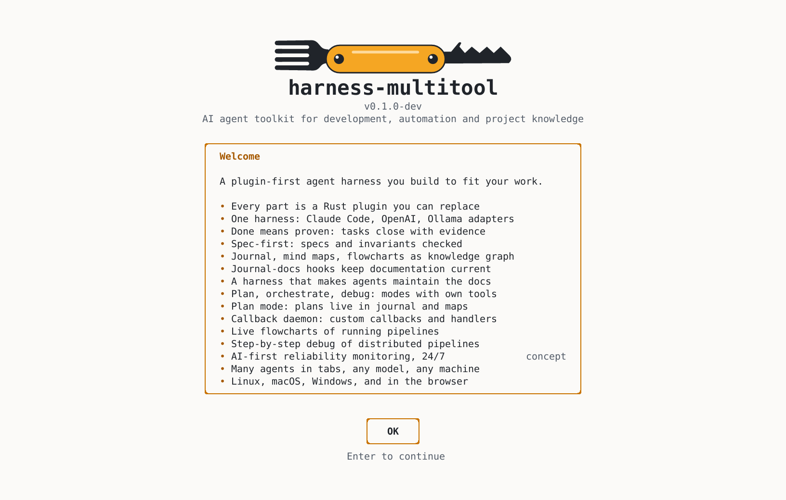

<p align="center">
  <picture>
    <source media="(prefers-color-scheme: dark)" srcset="docs/design/readme/hero-dark.png">
    
  </picture>
</p>

<p align="center">
  <a href="https://github.com/codefather-labs/harness-multitool/actions/workflows/ci.yml"></a>
  
  
  
</p>

<p align="center">
  <a href="#quick-start">Quick start</a> ·
  <a href="#what-it-does-today">What it does</a> ·
  <a href="#documents">Documents</a> ·
  <a href="docs/tui.md">Terminal UI</a> ·
  <a href="docs/spec/roadmap.md">Roadmap</a>
</p>

**A plugin-first agent harness in Rust.** An agent that writes code, runs tools and keeps a memory of why the project is the way it is, where almost every part is an interface you can replace.

## Quick start

```bash
git clone https://github.com/codefather-labs/harness-multitool
cd harness-multitool
./run.sh            # builds it and opens the terminal UI (Windows: run.ps1)
```

Open the settings with `Ctrl+,` and choose a provider: a key for an API, a local model on Ollama, or your ChatGPT plan through `gpt-subscription`, which signs in on OpenAI's own page.

## What it does today

- **The agent loop in a terminal UI:** streaming answers with Markdown and tables, tool calls with permission prompts, several tabs, sessions that resume, and what the agent is doing on the status line.
- **Models:** Anthropic and OpenAI-compatible APIs, Ollama and other local servers, a ChatGPT plan. The model list comes from each provider, with prices where they are known.
- **Plan mode:** the agent reads and plans, and nothing in the project can change until you approve.
- **Step-debug mode:** the agent walks a running pipeline step by step through a debug router built by one contract, and every finished cycle is saved.
- **Memory:** a project journal, mind maps and live flowcharts, which the agent's context is built from.
- **Done means proven:** a task finishes only when its checks pass, and the evidence goes into the journal.
- **Callbacks and channels:** events from outside reach the agent as data; conditions, custom handlers, and a Telegram channel.
- **Hot reload:** rebuild and swap the binary in the same terminal, with the sessions going on.

## What it is meant to be

- **Plugin-first.** The core is an agent loop and an event bus. Model providers, authentication, tools, permissions, context, memory, sessions and routing are interfaces, and the built-in ones are plugins of those same interfaces.
- **Modes are frameworks, not prompts.** A mode gives the agent its rules and tools, and the harness holds to them.
- **Many agents, many machines.** Sessions become addressable, message each other, and spread across machines and models.
- **Runs in the browser.** The core compiles to WebAssembly; the project site is to host the CLI itself as a live demo.

## Documents

| | |
|---|---|
| [Principles](docs/spec/principles.md) | what the project optimises for, and what it refuses |
| [Invariants](docs/spec/invariants.md) | what must hold at all times, and how each is checked |
| [Constraints](docs/spec/constraints.md) | rules, limits and constants |
| [Interfaces](docs/spec/interfaces.md) | every pluggable component: its contract and its boundaries |
| [Architecture](docs/architecture/overview.md) | how the pieces fit, with a map |
| [Terminal UI](docs/tui.md) | running it, keys, debug commands, screens as images |
| [Tools and modes](docs/tools.md) | what an agent can call, and how the harness's modes differ from utilities |
| [Design](docs/design/README.md) | the logo, icons, themes and the mockups the UI is built against |
| [Decisions](docs/decisions/) | why the project is the way it is (ADRs) |
| [Roadmap](docs/spec/roadmap.md) | the order of work |
| [Open questions](docs/spec/open-questions.md) | what is not decided yet |
| [References](docs/references.md) | projects we learn from |

Every rule in these documents has an id (`P-…`, `INV-…`, `CON-…`, `IF-…`). Code, tests and decisions cite them.

## On authentication and subscriptions

The project ships authentication for API keys, and a subscription sign-in only where the vendor documents one for apps like this ([ADR 0019](docs/decisions/0019-vendor-documented-sign-in.md)). A ChatGPT plan is signed in through OpenAI's flow for open-source apps. A Claude subscription is not offered: Anthropic's terms do not permit it in other apps, so Anthropic models take an API key.
