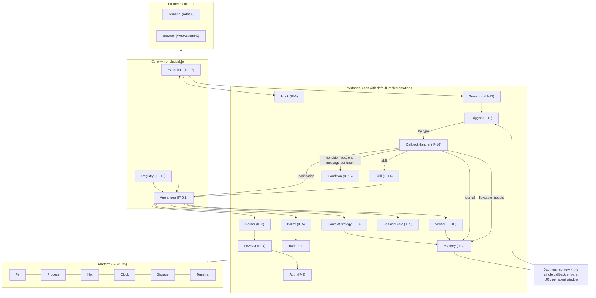

# Architecture

## Layers



## One turn of the loop


Every box is an event on the bus (IF-0.2) and an append to the session log (INV-5), which is what makes rewind and branching (IF-9) a fold over events rather than a feature bolted on.

## Session modes

A session runs in a mode (IF-0.5); entering a mode fires a hook that adds the mode's instructions (IF-6). Each mode is a framework, not a prompt (P-10):

| Mode | What it adds | Status |
|---|---|---|
| normal | the loop above | specified |
| step-debug | one reference flowchart per pipeline, callbacks in the client code, a debug router in the client app by one contract (approve, step back where possible), env gate `MULTITOOL_DEBUG_MODE=1` with auth, runs kept in `.harness/debug` ([ADR 0013](../decisions/0013-step-debug-mode.md)) | accepted |
| reliability monitoring | signals accumulate in the daemon; a `Condition` wakes the agent with one message per batch; per-project response policies in `.harness/policies`; sessions open 24/7 ([ADR 0014](../decisions/0014-reliability-monitoring-mode.md)) | concept |
| plan | only harness tools, read operations and web search; the plan is journal entries, mind maps and flowcharts ([ADR 0016](../decisions/0016-plan-mode.md)) | idea |

## Plugins and hot reload

Plugins are crates linked into the binary (CON-2). A reload rebuilds the local build and swaps the binary in the same terminal at a safe point, handing the in-memory view over to the new process, so sessions are not restarted ([ADR 0015](../decisions/0015-callback-handlers-are-plugins.md), CON-50).

## Documentation mirror

A project's journal, mind maps and flowcharts are mirrored into its `docs/` tree (CON-43): `project-init` creates the tree and `.harness/` (CON-44); a `PostToolUse` hook on every memory write tells the agent which file to update; a built-in check linked by doc id reminds it once at `Stop` and runs as `multitool docs check` in CI (CON-45) ([ADR 0017](../decisions/0017-docs-mirror-memory.md)).

## A local build

`crates/cli/src/plugins.rs` is where a local build lists its own callback handlers (IF-16); the daemon runs them.

## Builds

- **Native:** the core, every interface crate, the default plugins and the platform's native implementation; the user's own plugin crates are added in their local build (CON-2).
- **Browser:** the same core and interface crates compiled to `wasm32-unknown-unknown` (INV-1), with the browser implementations of the platform and the plugins that need no operating system. Tools that need processes are not offered (IF-21).

## A conversation and a task

A message runs turns until the model stops. With a verification protocol that is a *task*: it reaches `done` only through the verifier (INV-4), and a stop or a failure ends it. Without one it is a *conversation*: the model's stop waits for the next message, the task stays `running`, and a stop or a provider failure can be followed by another message.

## Debugging a feature

Each feature has its own way to be looked at without the rest of the system:

- `multitool screen <state> --png out.png` renders a state of the terminal UI to an image, through the same `draw` as the live UI.
- `multitool screen --scenario <name>` draws what a loop scenario leaves on screen; `tools/pty_session.py` drives the real UI in a pty against a fake provider endpoint.
- `multitool trace <scenario>` runs the real loop on test doubles and prints its log, one line per event (`--json` prints the lines the session store keeps); with no name it lists the scenarios. The tests in `crates/scenarios` run the same scenarios.

## Repository layout

Built today: `crates/api` (every interface, the events, the fold over the log), `crates/core` (loop, bus, registry), `crates/doubles` (a test double per interface), `crates/scenarios` (named runs of the real loop on doubles), the default plugins (`platform-native`, `auth-apikey`, `provider-anthropic`, `provider-openai`, `tools-builtin`, `policy-default`, `context-default`, `session-files`, `verifier-protocol`, `router-default`, `hooks-shell`, `memory-journal`, `tools-memory`), `crates/session` (the plugins from the configuration, a thread per session), `crates/daemon` (the callback entry, a URL per window), `crates/cli` (the `multitool` binary), `crates/frontend-tui` (the terminal UI) and `crates/tui-snapshot` (renders a frame to PNG with the same `draw`). The rest is the proposed layout:

```text
crates/
  core/            agent loop, event bus, registry, task states
  doubles/  scenarios/  session/
  api/             one module per interface: traits, types, errors (semver, INV-8)
  platform-native/ platform-wasm/
  provider-anthropic/ provider-openai/
  auth-apikey/
  tools-builtin/   read, edit, shell, search, fetch
  policy-default/  context-default/  session-files/  verifier-protocol/  router-default/
  memory-daemon/   memory-browser/
  frontend-tui/    frontend-web/    tui-snapshot/
  transport-daemon/
  cli/             the binary: config, registry wiring, frontends
docs/
```

## The architecture map

The high-level architecture is also kept as a mind map in the project's journal, shared with every session that works on the project, its nodes pointing at the decision and specification entries. This document and that map must agree; when they differ, that is a finding to settle.
