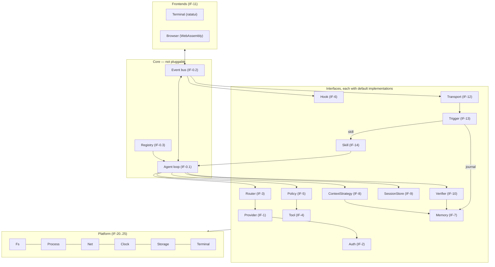
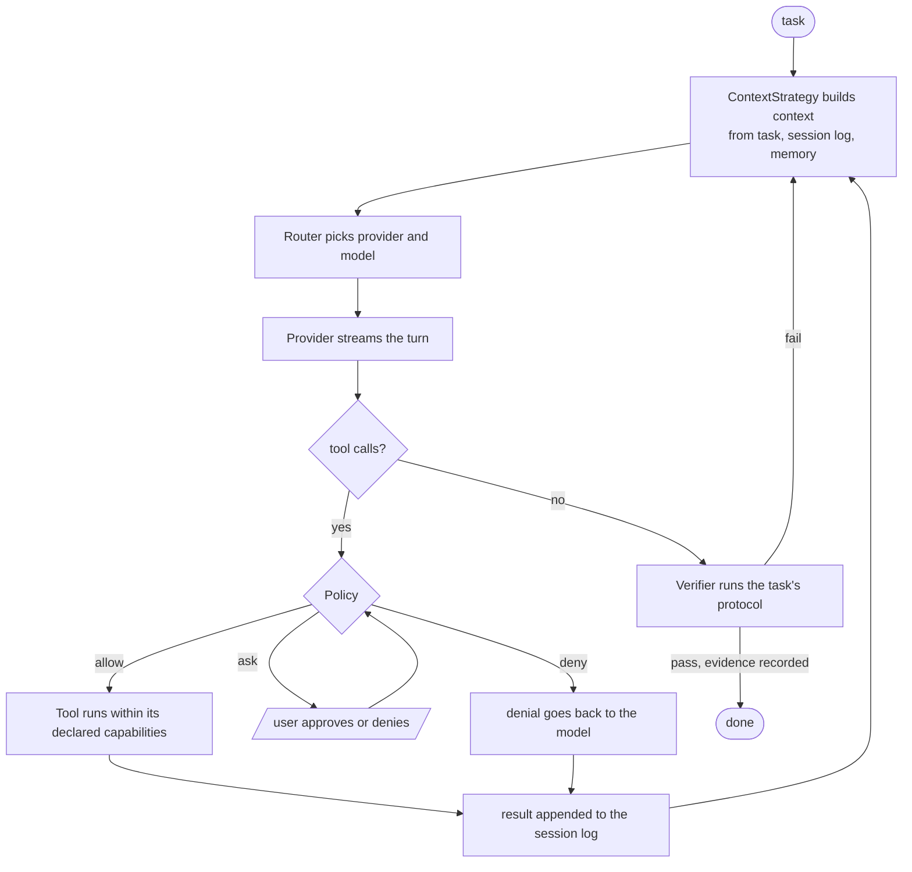

# Architecture

## Layers



## One turn of the loop



Every box is an event on the bus (IF-0.2) and an append to the session log (INV-5), which is what makes rewind and branching (IF-9) a fold over events rather than a feature bolted on.

## Builds

- **Native:** the core, every interface crate, the default plugins and the platform's native implementation; the user's own plugin crates are added in their local build (CON-2).
- **Browser:** the same core and interface crates compiled to `wasm32-unknown-unknown` (INV-1), with the browser implementations of the platform and the plugins that need no operating system. Tools that need processes are not offered (IF-21).

## Repository layout (proposed)

```text
crates/
  core/            agent loop, event bus, registry, task states
  api/             one module per interface: traits, types, errors (semver, INV-8)
  platform-native/ platform-wasm/
  provider-anthropic/ provider-openai/
  auth-apikey/
  tools-builtin/   read, edit, shell, search, fetch
  policy-default/  context-default/  session-files/  verifier-protocol/
  memory-daemon/   memory-browser/
  frontend-tui/    frontend-web/
  transport-daemon/
  cli/             the binary: config, registry wiring, frontends
docs/
```

## The architecture map

The high-level architecture is also kept as a mind map in the project's journal, shared with every session that works on the project, its nodes pointing at the decision and specification entries. This document and that map must agree; when they differ, that is a finding to settle.
