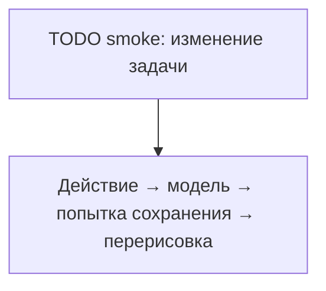
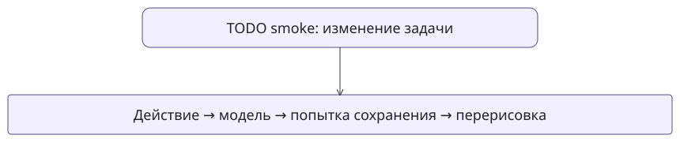

# TODO smoke — учебный пример

Doc ids: IF-4, IF-7 (демонстрация инструментов; не новый контракт harness).

Приложение в `examples/todo-smoke` не использует библиотеки или сборку.
`app.mjs` управляет DOM и localStorage; `model.mjs` содержит чистые операции;
`model.test.mjs` проверяет модель восемью тестами. Это соответствует карте #3
«TODO smoke: устройство учебного приложения» (корень #5, факт #7).

Возможности: добавление непустой задачи, переключение выполнения, удаление,
счётчик и сохранение в браузере. Если хранилище недоступно, приложение работает
в памяти и показывает предупреждение. Текст задач вставляется через textContent.

## Изменение задачи — схема #4

Корень #6: «TODO smoke: изменение задачи». Узел #8:
«Действие → модель → попытка сохранения → перерисовка».





## Проверка

```sh
node --test examples/todo-smoke/model.test.mjs
node --check examples/todo-smoke/app.mjs
```

Восемь тестов модели прошли: добавление, пустой текст, переключение,
удаление, неизвестные id, загрузка сохранённых данных, повреждённое или
недоступное хранилище, фильтрация некорректных записей. UI в браузере
автоматически не проверялся.

## Запуск

Из корня репозитория:

```sh
python3 -m http.server 8000 --bind 127.0.0.1 --directory examples/todo-smoke
```

Открыть http://127.0.0.1:8000. Остановить сервер: Ctrl+C.
