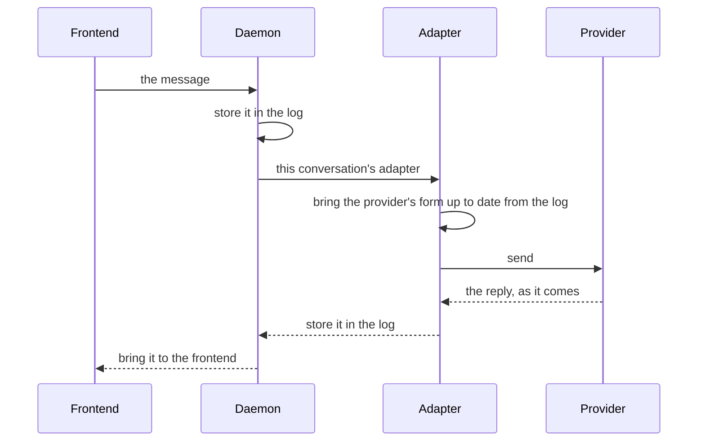

# Conversations

How the harness stores a conversation and carries it between providers. It is the specification behind [ADR 0022](../decisions/0022-claude-code-conversations.md), [ADR 0023](../decisions/0023-the-log-is-the-conversation.md) and [ADR 0024](../decisions/0024-conversations-live-in-the-daemon.md).

## The invariants

| Id | Invariant |
|---|---|
| **INV-15** | **The daemon holds the conversation.** A conversation is always stored, and every message in and out goes through the daemon. Frontends and adapters never hold a conversation of their own. |
| **INV-16** | **One consistent conversation.** The daemon's log is the one account of what was said. A provider's own form of a conversation is derived from it and brought up to date from it. |
| **INV-17** | **The format is the harness's own.** The log depends on no provider: it stays readable and usable with any provider disconnected. |
| **INV-18** | **Any adapter, at any time, in any direction.** A conversation can be switched to any connected adapter between any two messages, and goes on with what was said so far. |
| **INV-19** | **A connected adapter brings its provider's conversations.** Connecting a provider's adapter means reading that provider's conversations, writing into them, and resuming them in the harness. |

## One message

Every adapter follows the same chain.

A frontend sends operations and hears events: it holds a view, not the conversation. Everything the engine does (its log, its tools, its calls to a provider) happens in the daemon (IF-19, CON-75).

## The format

The conversation is the session's event log (INV-5): one JSON line per event, appended in order. Two things read it.

- **Frontends** draw every event: messages, tool cards, hooks, modes.
- **The history a model is sent** is a fold of the log (`SessionState`), holding messages made of text, tool calls and tool results.

What the log holds about a provider is marked as such and is never needed to read the conversation: a block a model signed for itself (`OpaqueBlock`), and the id of a session a provider keeps of its own (`BackendSession`, `ConversationImported`).

## The forms of a conversation

| Provider | Its form | Reading it | Writing it |
|---|---|---|---|
| Claude Code | a transcript file it keeps, per directory (IF-18) | `multitool import claude-code`, along the real chain of the file | a new transcript from the log, before the first message that needs it (CON-74) |
| ChatGPT plan, OpenAI-compatible, Ollama | the history in each request; nothing is kept with the provider | — | built from the log for every request |
| Anthropic API | the history in each request | — | built from the log for every request, with the blocks this model signed |

With Claude Code, the transcript is brought up to all earlier history and the new message goes as the prompt, and Claude Code records it itself. It refuses to go on from a file with no prompt, and writing the message first would send it twice. The end state is the one the chain describes: both hold the message before the reply starts.

## Transformation

Whatever made the log, what a provider receives is valid for it (`provider_ready`, CON-73).

| What the log has | What the provider gets |
|---|---|
| Text, tool calls, tool results | The same, in its own wire form |
| Two user messages in a row | One message |
| A tool result and typed text together | The result first, then the text |
| A call with no result, cut off by a stop or a compaction | The call, answered with "no result in the record" |
| A result whose call is not in what is sent | Nothing |
| A block another provider or model signed | Nothing: it goes only to the model that made it |
| A summary from a compaction | The summary, and nothing from before it; older requests stay as a one-line note |

Reading a provider's form leaves things out, on purpose (CON-72):

- A rewound branch and a subagent's lines were never part of the conversation.
- Reasoning blocks stay behind, and Claude Code's own wrapping is not the user's words.
- Images become a marker, and a tool result keeps its first 4 KiB. The whole stays in the provider's record.

## Switching

- **To a provider with no form of its own:** the next request is built from the log. A backend session the log remembers no longer holds everything, so it is dropped (`BackendSessionLost`).
- **To Claude Code, after turns elsewhere:** the log is written as a new transcript, and that session is resumed from then on.
- **To Claude Code, from one of its own conversations with nothing elsewhere since:** its own session goes on, with its full record.
- **A conversation brought in** goes on in a fork made at its first message (`--fork-session`). The original stays whole, and can be opened in Claude Code as before (CON-71).

## When things go wrong

| Case | What happens |
|---|---|
| A window goes away | Its runs finish in the daemon. The log has the reply, and the next window shows it (CON-76). |
| A prompt with nobody to answer | A denial, once the window has not polled for 30 seconds. |
| A session opened while its run is on elsewhere | Refused, saying why: one writer to a log (CON-77). |
| The daemon stops | Its windows say so. The log keeps everything up to its last flush, and the conversation opens again. |
| A daemon of another build | Replaced when idle. If it is running conversations, the window works on its own. |
| Claude Code will not load a transcript | An error on screen, not a silent loss of context. Its format is undocumented and can change with its version. |
| A damaged line in a provider's file | Passed over and counted (CON-72). |

## How it is checked

| Check | What it proves |
|---|---|
| `tools/pty_daemon.py` | A TUI killed in the middle of a reply: the daemon finishes, the denied tool never runs, and a new window shows the reply and goes on |
| `tools/real_transform.py` | One session through real providers, each naming what the earlier ones were told |
| `tools/pty_import.py` | A conversation brought in: drawn, forked at the first message, then resumed; the original's bytes unchanged |
| `crates/session/tests/e2e.rs` | The daemon and a client in one process; a session brought in going on with another provider |
| `crates/api/src/model.rs`, `crates/backend-claude-code/src/conversations.rs` | The rules of transformation; a written transcript reading back equal |
