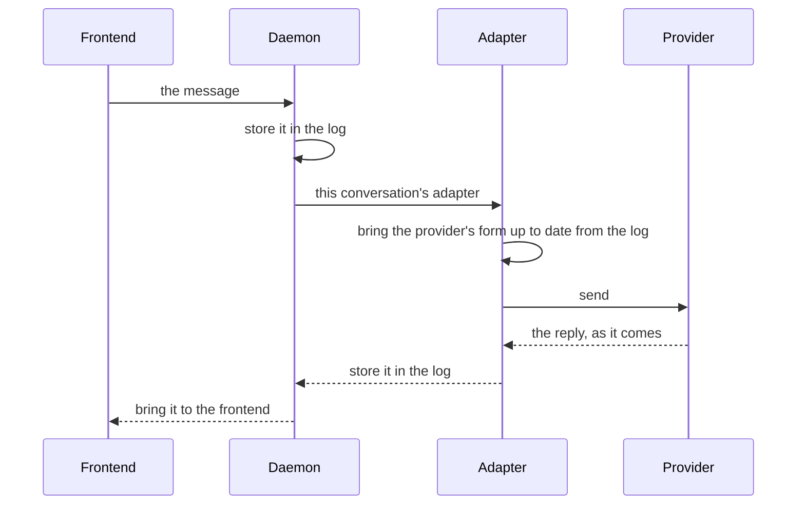
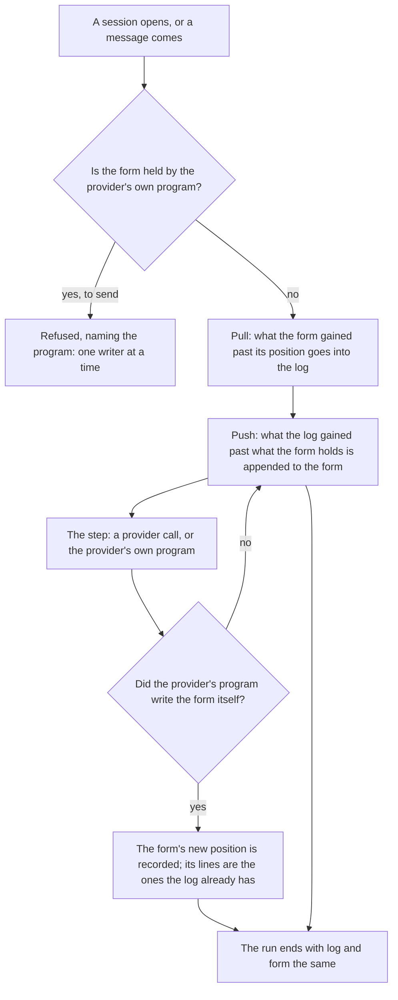

# Conversations

How the harness stores a conversation and carries it between providers. It is the specification behind [ADR 0022](../decisions/0022-claude-code-conversations.md), [ADR 0023](../decisions/0023-the-log-is-the-conversation.md) and [ADR 0024](../decisions/0024-conversations-live-in-the-daemon.md) and [ADR 0025](../decisions/0025-one-conversation-in-every-form.md).

## The invariants

| Id | Invariant |
|---|---|
| **INV-15** | **The daemon holds the conversation.** A conversation is always stored, and every message in and out goes through the daemon. Frontends and adapters never hold a conversation of their own. |
| **INV-16** | **One consistent conversation.** The daemon's log is the one account of what was said. A provider's own form of a conversation is derived from it and brought up to date from it. |
| **INV-17** | **The format is the harness's own.** The log depends on no provider: it stays readable and usable with any provider disconnected. |
| **INV-18** | **Any adapter, at any time, in any direction.** A conversation can be switched to any connected adapter between any two messages, and goes on with what was said so far. |
| **INV-19** | **A connected adapter brings its provider's conversations.** Connecting a provider's adapter means reading that provider's conversations, writing into them, and resuming them in the harness. |
| **INV-20** | **Consistent at every moment, by design.** Every form of a conversation that exists holds what the log holds, and the log holds what the form holds. No step of a conversation is taken on a stale side: what a form gained outside the harness reaches the log before anything reads it, and what the log gained reaches the form before the next call to any provider and when a run ends. |
| **INV-21** | **There and back, at any moment.** A conversation can move between the harness and a provider's own program in either direction, any number of times, with nothing lost and nothing to do but open it there. It stays one conversation: no copy, no fork, the same id. |

## One message

Every adapter follows the same chain.

Around every step the daemon keeps the forms in line with the log, whichever adapter runs the step:

A frontend sends operations and hears events: it holds a view, not the conversation. Everything the engine does (its log, its tools, its calls to a provider) happens in the daemon (IF-19, CON-75).

## The format

The conversation is the session's event log (INV-5): one JSON line per event, appended in order. Two things read it.

- **Frontends** draw every event: messages, tool cards, hooks, modes.
- **The history a model is sent** is a fold of the log (`SessionState`), holding messages made of text, tool calls and tool results.

What the log holds about a provider is marked as such and is never needed to read the conversation: a block a model signed for itself (`OpaqueBlock`), and the id of a session a provider keeps of its own (`BackendSession`, `ConversationImported`).

`FormSynced` links a session to a form: which provider, its id, the position reached in that form, and how many messages of the session the form holds. The next pull starts at that position and the next push at that count, so neither side is ever read or written twice, and a build without the adapter simply leaves the form behind until one with it opens the session.

## The forms of a conversation

| Provider | Its form | Reading it | Writing it |
|---|---|---|---|
| Claude Code | a transcript file it keeps, per directory (IF-18); `claude --resume` keeps its id and file | its real chain, whole on import and past the position after that | lines appended on its chain, and a new transcript for a session that has none (CON-74) |
| ChatGPT plan, OpenAI-compatible, Ollama | the history in each request; nothing is kept with the provider | — | built from the log for every request |
| Anthropic API | the history in each request | — | built from the log for every request, with the blocks this model signed |

With Claude Code, the transcript is brought up to all earlier history and the new message goes as the prompt, and Claude Code records it itself. It refuses to go on from a file with no prompt, and writing the message first would send it twice. The end state is the one the chain describes: both hold the message before the reply starts.

What the harness adds to a provider's form is only ever appended: every byte that was there stays as it was. A form is created for a session the first time the session goes on through that provider; one that exists is kept current from then on, through any other provider's turns.

## Transformation

Whatever made the log, what a provider receives is valid for it (`provider_ready`, CON-73).

| What the log has | What the provider gets |
|---|---|
| Text, tool calls, tool results | The same, in its own wire form |
| Two user messages in a row | One message |
| A tool result and typed text together | The result first, then the text |
| A call with no result, cut off by a stop or a compaction | The call, answered with "no result in the record" |
| A result whose call is not in what is sent | Nothing |
| A block another provider or model signed | Nothing: it goes only to the model that made it |
| A summary from a compaction | The summary, and nothing from before it; older requests stay as a one-line note |

Reading a provider's form leaves things out, on purpose (CON-72):

- A rewound branch and a subagent's lines were never part of the conversation.
- Reasoning blocks stay behind, and Claude Code's own wrapping is not the user's words.
- Images become a marker, and a tool result keeps its first 4 KiB. The whole stays in the provider's record.

## Switching

- **To a provider with no form of its own:** the next request is built from the log. A form the session has stays linked, and gets these turns too.
- **To Claude Code, with a form:** that same conversation goes on: what other providers said was appended to it, and it resumes by its own id.
- **To Claude Code, with no form yet:** the log is written as a new transcript, and that one is the session's form from then on.

### The harness's tools for a delegate

A delegate gets the harness's own tools over MCP, whichever way its row runs: `multitool mcp` serves the journal, maps and flowcharts of the daemon, the Telegram channel and the reload (`mcp__harness__*`). So an agent needs nothing outside the harness to keep its records.

### An agent changing the harness

An agent can change the harness it runs in. `plugins_reload` builds from the source at once, while its turn goes on. A failed build comes back to it as its next message, with the error, and nothing is swapped. A good one swaps at the safe point, when the daemon has no run on in any window, a message the user sent meanwhile included, and it decides that itself, closing in the same step: the process and the daemon are replaced, the daemon's delegates ending with it, the conversations reopen from their forms, and the tab that asked gets a message from the harness, which starts its next turn. A reload the user asked for sends no message.

### Bringing a journal in

`multitool journal import [--aside] <file|->` brings in a journal and its maps from a stream of JSON documents, `{"entries": [...]}` and `{"map": {...}}`, under the ids they have, so that what cites them still means them. Run again, it updates what changed; other text under an id refuses the whole import. `--aside` moves what is there out of the way first, renamed and not deleted. `multitool journal export` prints the same stream.

### Running inside a launcher

`./run.sh --under "<launcher>"` runs the harness inside a program that starts `claude` from the PATH and gives it an identity and messages. The harness takes the place of `claude` there, and a delegate still finds the real one. What the launcher sets reaches sessions as a window's environment, and what it types reaches the composer as a paste:

- A message is known by the prefix it starts with, and goes in as what it is: Telegram, an agent, a callback or a reminder, with its own card and toast, marked as coming from outside (INV-12), not as the user's words. Only the start of a paste counts, so a line inside a body cannot pass for a sender. With a run on it waits its turn, and with no session open it waits for one. The Enter that came with it answers no prompt and opens no session.
- A paste from the user waits in the composer, line breaks and all.

A delegate is `claude -p`, and Claude Code offers some tools only in its interactive mode: asking with options, its plan mode, and artifacts. Under the harness those are the harness's own, or absent.

### Changing the adapter in the settings

Choosing another adapter or model in the harness's settings moves every open conversation of the window onto it, at once:

- The choice is saved by the harness itself: nobody edits a configuration file to change an adapter, and the next start opens on the same one.
- The daemon reconnects each conversation and brings its form for the chosen adapter in line with the log at that moment (INV-20), creating it if that adapter keeps conversations and has none for this one yet. Its next message goes through the new adapter. The status line says so straight away. Nothing has to be reopened.
- **The window waits for the daemon.** Bringing a form in line can take long: writing a form the adapter does not have yet means the whole conversation, and a long one runs to gigabytes. From the moment it starts until the daemon signals success or failure, the window shows the moon-phase spinner with what is being done, and takes no input: no message, no command, no other control. Failure leaves the window usable, says what went wrong, and the conversation stays on the adapter it had. The same holds for opening a conversation whose form has to be read or caught up (CON-81).
- The context window is a dropdown beside them, per provider: Auto takes what the server or the model reports, and a chosen value wins over a report and is what compaction goes by. A delegate compacts by itself, so there it decides only what the status line counts against (CON-80).
- **While a run is on, the adapter cannot be changed.** While any conversation of the window has a run on or a prompt waiting, the adapter, model and context window controls are shown disabled, wherever they are, and choosing one changes nothing and says why. They come back when the last run ends.
- The daemon holds to the same rule: a change that reaches it during a run is refused, so no frontend can move a conversation in the middle of a run (CON-79).

## Moving between the harness and a provider's program

- **Onto the harness:** open it. A provider's conversation listed for this directory or brought in with `multitool import` is linked, not copied: opening it pulls what it gained. Importing it again gives the same session.
- **Back:** open the same id in the provider's program, `claude --resume <id>`. Every turn made in the harness is already in its file, on any provider. Turns made there come back the same way at the next open.
- **One writer at a time:** while the provider's own program has the conversation open, the harness shows it live but refuses to send, naming the program (CON-78). Leave it there and send again.

## When things go wrong

| Case | What happens |
|---|---|
| A window goes away | Its runs finish in the daemon. The log has the reply, and the next window shows it (CON-76). |
| A prompt with nobody to answer | A denial, once the window has not polled for 30 seconds. |
| A session open in a window still there | Refused, saying why: one writer to a log (CON-77). |
| A session whose window went away, its run still on | The run comes to the window opening it: what was said, a waiting prompt, the rest live. |
| The form was rewound in the provider's program | The log only grows: it gains the new branch and says that a rewind happened. |
| A form cannot be written | An error on screen. The count of what it holds has not moved, so the next step tries again from there. |
| A conversation open in the provider's program | Sending is refused, naming it (CON-78). |
| The adapter is changed while a run is on | Not possible: the controls are disabled, and the daemon refuses (CON-79). |
| A conversation cannot be reconnected to the chosen adapter | The daemon signals the failure and the spinner ends. An error on that conversation's tab; it stays on the adapter it had, and the status line shows that one. |
| The window goes away during a sync | The daemon finishes it: an append is whole lines, and a new form appears whole or not at all. The next window opens it as it stands. |
| The daemon stops | Its windows say so. The log keeps everything up to its last flush, and the conversation opens again. |
| A daemon of another build | Replaced when idle. If it is running conversations, the window works on its own. |
| Claude Code will not load a transcript | An error on screen, not a silent loss of context. Its format is undocumented and can change with its version. |
| A damaged line in a provider's file | Passed over and counted (CON-72). |

## How it is checked

| Check | What it proves |
|---|---|
| `tools/pty_daemon.py` | A TUI killed in the middle of a reply: the daemon finishes, the denied tool never runs, and a new window shows the reply and goes on |
| `tools/real_move.py` | Real Claude Code and a real other provider: a conversation made in one, moved back and forth, each side naming every word told on the other; bytes before each append unchanged |
| `tools/pty_attach.py` | A TUI killed with a run on: the next window takes the run over with its prompt, and nothing shows twice |
| `tools/real_transform.py` | One session through real providers, each naming what the earlier ones were told |
| `tools/pty_import.py` | A conversation brought in: drawn, forked at the first message, then resumed; the original's bytes unchanged |
| `crates/session/tests/e2e.rs` | The daemon and a client in one process; a session brought in going on with another provider |
| `crates/api/src/model.rs`, `crates/backend-claude-code/src/conversations.rs` | The rules of transformation; a written transcript reading back equal |
